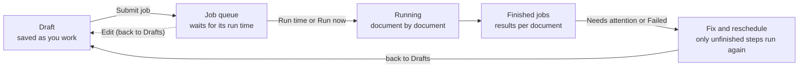

# BMU v2.0: what's changing

BMU v2.0 does the same job as the Bulk Media Uploader you use today (the legacy BMU): it takes a batch of image,
audio, video, 3D and PDF files and creates Media records for them in CollectionSpace, linked to their objects. What
changes is how you prepare a batch, who can do what, and what you see when something goes wrong.

This overview is for staff and interns at PAHMA and UCJEPS who upload media. Those two museums move to BMU v2.0
first; the other museums follow later.

## At a glance

| | Legacy BMU | BMU v2.0 |
| --- | --- | --- |
| Records in CollectionSpace are created as | One shared BMU account | You (the staff member who submits the job) |
| Who can use it | Anyone with a CollectionSpace account at the museum, whatever its roles | Staff and interns with a BMU role in CollectionSpace |
| Job size | Up to about 100 files | Designed for up to 1,000 files |
| Handling (link to object, create object, media only) | One choice for the whole job | Chosen per document; a job can mix them |
| New choice | | Link to object, and create it if it's missing (PAHMA) |
| Creator, contributor, rights holder | Short fixed lists | Search CollectionSpace's own names as you type |
| Language and media type | Set automatically | Shown and editable per document |
| Publish setting | One checkbox for the whole job | Per document (PAHMA and UCJEPS: Restricted) |
| Checking your work | After the job runs, in a list of failed files | As you work, on each document, before you submit |
| Saving unfinished work | Not possible | Drafts save every change and are shared with your museum |
| When jobs run | At fixed times set on the server; anyone can start a waiting job | Your museum's run times (default 7:00 PM daily); staff can run a job now, reorder or hold jobs |
| Results | Count of files loaded and a list of failures | Every document's outcome, with plain-language problems and what to do |
| Fixing a failed job | Start a new job | Fix and reschedule; only the unfinished steps run again |
| Sensitive objects | No special handling | Files of sensitive objects are protected automatically |

## Signing in, and who can do what

You sign in with your own CollectionSpace account. BMU v2.0 then works in CollectionSpace as you, so every record it
creates shows who made it.

Each person has one of two BMU roles, given by your CollectionSpace administrator:

| | Staff | Intern |
| --- | --- | --- |
| Create drafts and add files | Yes | Yes |
| Edit drafts | Any draft | Drafts open to interns |
| Submit a job to run | Yes | No: uses **Submit for review** instead |
| Change the job queue and run times | Yes | No (can see them) |
| Fix and reschedule a finished job | Yes | No (can see results) |

- **Interns prepare, staff submit.** An intern sends a finished draft for review. A staff member checks it and
  submits it, and the job runs with that staff member's sign-in.
- **If your account is missing something**, sign-in says what is missing and asks you to contact your
  CollectionSpace administrator.
- **Sessions end** after 30 minutes without activity, or after 8 hours. Your work is already saved.

## Preparing a job

In the legacy BMU you fill in one form for the whole batch. In BMU v2.0 each file is its own document, with its own
settings, and a side panel changes many documents at once.

**Adding files**

- Drag files in or pick them. Each file uploads in the background and shows a thumbnail; a failed upload has Retry
  and Remove.
- Accepted: JPEG, TIFF, PNG, PDF, WAV, MP3, AAC, MP4 and X3D. PDF is new. Other files are skipped, with a message
  naming them.
- Filenames work as they do now. PAHMA: the object number, then optionally `_` and anything else (`15-1234_a.jpg`).
  UCJEPS: the accession number, up to the first `.` or `_`. A wrong name can be corrected in the BMU.
- The date is taken from the image's EXIF data when there is one, as it is now.

**Handling, per document.**

| BMU v2.0 | Legacy equivalent | Museums |
| --- | --- | --- |
| Link to existing object | Create media record and link to existing object (UCJEPS: accession) | PAHMA, UCJEPS |
| Create new object + link | Create both a media record and a linked "skeletal" cataloging record | PAHMA, UCJEPS |
| Link to object (create if missing) | New: links when the object exists, creates it when it doesn't | PAHMA |
| Media only (no object) | Create media record only | PAHMA, UCJEPS |
| Slide (no object) | Upload as slide | UCJEPS |
| Not yet available | Upload as born-digital (DP numbering) | UCJEPS |

**Fields, per document.** Identification number, date, media type, language, creator, contributor, rights holder,
description, copyright and the publish setting.

- **Names come from CollectionSpace.** Creator, contributor and rights holder search CollectionSpace's people and
  organizations as you type, in place of the legacy BMU's short fixed lists. The BMU never creates names.
- **Dates are read the way CollectionSpace reads them**, so they work in date searches. The legacy BMU fills in only
  the display date.
- **Language** (English by default) and **media type** can be changed per document, or for many at once.
- **The side panel** applies a value to the selected documents or to all of them. Each document keeps its own copy,
  which is exactly what is sent.
- The legacy "Override always / Override if blank" choices for values in the image file are gone: what you see in
  the document is what is sent.

**Groups.** As now, a job can create a CollectionSpace Group of its objects (UCJEPS: Folder). Tick "Create a group
of this job's objects" and give it a title, or fill it with **Use the job name** or **Use a timestamp**. A blank
title no longer means "no group": the checkbox decides.

## Checks before you submit

In the legacy BMU most problems show up only after the job has run. BMU v2.0 checks each document against
CollectionSpace when you add it and every time you change it, and shows the result on the document:

- **Must fix** (red): stops the job from being submitted. For example, no object has that number, several objects
  share it, or a name was deleted in CollectionSpace.
- **Warning**: worth a look, but doesn't stop you. For example, another Media record already has the same
  identification number.
- **Information**: for example, a renamed name was updated to its current form.

The BMU also checks the job against the jobs ahead of it in the queue, such as two jobs creating the same object.

A permission you lack is never shown as a mistake in the job. A document that needs a new object, when you can't
create objects, is marked for a colleague who can. A permission your account lacks for the whole job, such as
creating groups, gets one message to take to your CollectionSpace administrator.

Everything is checked once more just before each document runs, so a change in CollectionSpace in the meantime stops
that document before anything is created for it.

## Drafts and working together

In the legacy BMU a batch has to be finished in one sitting. In BMU v2.0 every unfinished job is a draft, saved as
you work, and you can leave and come back.

- **Shared with your museum.** Everyone signed in to your museum's BMU can see every draft. Staff can open any draft;
  interns can open drafts open to interns.
- **One editor at a time.** The Drafts tab shows who is editing a draft. Someone else can take it over after a
  warning; nothing is lost, because every change is already saved.
- **Drafts expire** 30 days after they were last saved, or 7 days if a file in them is protected (see Sensitive
  objects). The Drafts tab shows each draft's expiry date.
- **A submitted job can be taken back.** Edit a waiting job and it returns to Drafts; submit it again to put it back
  in the queue, at the end.

## When jobs run

Submitted jobs wait in your museum's **Job queue** and run at the museum's run times, one job at a time, in the order
shown. The default is every day at 7:00 PM Pacific.

Edit takes a waiting job back to Drafts; Fix and reschedule does the same for a finished job that needs attention.

- **Everyone sees** when each job will run, and which staff member's sign-in it will use.
- **Staff can** change the run days and times, pause and resume the queue, reorder jobs, give a job **Run now**, its
  own run time or a hold, and cancel a run. In the legacy BMU anyone can start any waiting job from the queue page.
- **If a new order would make a document fail**, for example a job that creates an object moved ahead of the job
  that needs it, the BMU says so before the change.
- **A job must run within 4 days of being submitted.** The submitter's sign-in is kept, encrypted, for at most 96
  hours. If it runs out first, the job goes back to Drafts to be submitted again.
- **You can follow a running job** document by document in the queue.

## Results and fixing problems

In the legacy BMU the queue page gives a count of files loaded and a list of the filenames that failed, and a failed
file means starting a new job. In BMU v2.0, the **Finished jobs** tab shows each job as **Completed**, **Needs
attention** or **Failed**, and keeps what went wrong until you deal with it.

- **View results** lists every document, what was created for it in CollectionSpace, and any problem in plain
  language: what happened, and what to do about it. Technical detail is there for support, one click away.
- **Fix and reschedule** puts the job back in Drafts so you can correct it (a wrong object number, a file to replace)
  and submit it again. When nothing needs changing, for example CollectionSpace was briefly unavailable, the button
  is **Reschedule**.
- **Only unfinished steps run again**, so a rerun doesn't repeat what already worked.
- **A job stops by itself** if CollectionSpace stops answering or the sign-in is refused; finished documents are
  kept, and Reschedule continues it.
- **The BMU never changes or deletes anything in CollectionSpace.** Deleting a job removes it from the BMU only.
- **Completed jobs are removed from the list 30 days after they finish.** Jobs that need attention or failed stay
  until someone deletes them, and a fix that isn't submitted within 30 days is undone.

## Sensitive objects and publishing

BMU v2.0 knows when an object is sensitive and handles its files with more care. The legacy BMU treats every file
the same.

- **Protected files.** When a document's object is marked sensitive in CollectionSpace (at PAHMA, for example,
  culturally sensitive or NAGPRA-restricted objects), the BMU marks its file as protected. Nobody marks or unmarks
  this by hand.
- **What protection means:** no thumbnail is kept in the BMU, so other people see a locked placeholder; the file is
  set not to publish by default; and the BMU deletes its copy of the file sooner.
- **Publishing is set per document.** At PAHMA and UCJEPS it shows as a **Restricted** checkbox (checked means not
  published). In the legacy BMU one "Approved for Web" checkbox covers the whole job.
- **The Public portal column** shows what the public will see for each document, and why: public, hidden because the
  object is sensitive, or hidden because the image is restricted. The museum's public portal makes the final
  decision.
- **Softer signals are warnings.** For example, a PAHMA display restriction at the "preference" level suggests
  withholding the image, but doesn't decide for you.

Which CollectionSpace fields make an object sensitive is still being confirmed with PAHMA and UCJEPS.

## What stays, what's gone, what isn't ready yet

**Stays the same**

- Filenames carry the object number.
- The same Media record fields are filled in, plus Language.
- Groups of a job's objects.
- Jobs still run in the evening, not the moment you submit (staff can use Run now).

**Gone**

- One form for the whole job: settings are per document, with the side panel for many at once.
- "Override always / Override if blank" for values in the image file.
- Starting any waiting job from the queue page: only staff run, hold or reorder jobs.

**Not ready yet**

- The other museums: BAMPFA, the Botanical Garden and Cinefiles.
- Checks of a TIFF's technical quality.
- Uploading to the Restricted Media record type.
- UCJEPS: the Source and Locality fields, and born-digital (DP number) handling.
- A screen for reading the BMU's history of who did what (the history is already kept).
